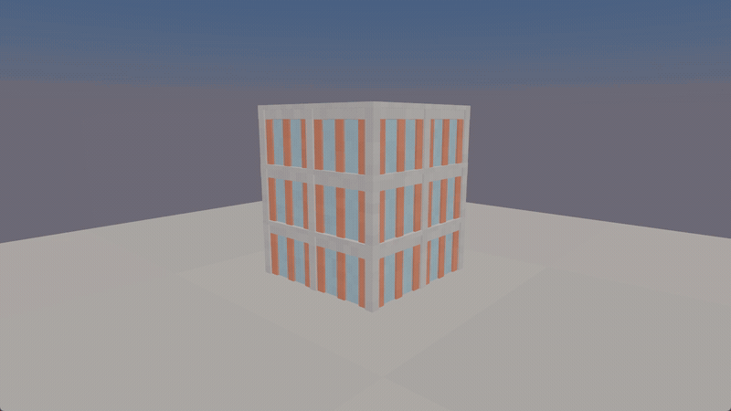

# Talus Physics

Talus is a C++23 physics library for integration into game engines. It provides
rigid bodies, compound collision shapes, deformable bodies, plastic deformation,
tearing, material-driven structural fracture and a fixed-step simulation pipeline.

The host engine owns scenes, rendering, input, audio, networking and game logic.
Talus owns physical state and returns motion, contacts and destruction events.
The former standalone game engine, renderer, editor, player and C# runtime are
removed from the current tree.



Three-storey concrete-frame collapse, rendered with the original Talus testbed.

## Features

### Rigid bodies and collision

- Boxes, spheres, compound bodies and sampled signed-distance-field shapes.
- Broad-phase collision detection, persistent contact manifolds, speculative
  contacts and continuous collision handling for moving bodies.
- Friction, restitution, sleeping, impulses and runtime body or shape edits.
- Compound-child removal and splitting, with mass and inertia recomputed for
  the resulting pieces.

### Joints

- Ball, hinge and swing-twist joints between rigid bodies or to the world,
  with rigid angle limits and an elliptical swing cone.
- Drives with physical stiffness and damping on each axis, per-direction
  torque bounds and a torque cap, so a response does not depend on how light
  the joined bodies are.
- Strength-limited spring joints that slip at their force or torque cap, for
  grips and tethers.
- Joined pairs that do not collide, and per-joint force, torque and saturation
  read-back.
- Islands that contain a joint, with every body they touch, step with their
  own substep count; other islands are unaffected. Joints keep their anchors
  through compound splits.

### Deformation and material history

- Finite-element deformation with elastic recovery, plastic flow and hardening.
- Material parameters for density, stiffness, damping, yield and tearing.
- Persistent plastic deformation and mesh tearing, including updated surfaces
  and collision geometry.
- Transitions between rigid and deformable representations, retaining supported
  deformation history when a body returns to rigid motion.
- CPU signed-distance-field construction, material queries and field updates.

### Structural fracture and destruction

- Connected chunks with stress-based compression, tension and shear failure.
- Intact, cracked and broken bonds, including frictional bearing after cracking.
- Concrete, reinforced concrete, brick, timber, glass and steel material presets,
  with support for direction-dependent strength and material variation.
- Chunk removal, material-based subdivision and separation into moving compound
  bodies when connections fail.
- Contact loads, blasts and scheduled destruction actions.

### Simulation and integration

- Fixed-step simulation, with a default timestep of 1/60 second.
- Multithreaded CPU stepping, runtime SIMD selection and optional host task
  callbacks for integration with an existing scheduler.
- Sleeping and freezing/thawing mechanisms, plus a workload controller for
  deferring structural work.
- Ray queries, contact-hit and destruction reports, workload counters and
  per-stage timing data.
- Determinism regression coverage across the tested Windows/MSVC and Linux/GCC
  builds, worker counts and SIMD widths.
- CMake embedding or an installed `Talus::Physics` package, with headless examples.

Current performance, contact, fracture and joint limitations are documented in
[physics status](docs/physics-status.md). The workload controller is not a hard
real-time guarantee, and game-engine adapters remain separate work. Joint usage
is described in [integration](docs/integration.md#joints).

## Use from another CMake project

```cmake
add_subdirectory(external/talus)
target_link_libraries(my_adapter PRIVATE Talus::Physics)
```

```cpp
#include <talus/talus.h>

talus::World world;
world.dynamics.workerCount = 8;
// Add bodies, then call once per fixed physics tick.
auto report = world.step();
```

The library requires GLM, Eigen and system threading. CMake can fetch the pinned
header dependencies when they are not installed. It requires no graphics API,
windowing library, ECS, .NET runtime or other physics engine. Tests additionally
fetch Catch2. See [third-party notices](THIRD_PARTY_NOTICES.md).

The initial integration API is C++; it is not a stable binary ABI. Godot, Unity
and Unreal adapters are not included yet. See [integration](docs/integration.md)
for ownership, timing and packaging requirements.

## Build and test

Use CMake 3.28+, Ninja and a C++23 compiler on x86-64. On Windows, use an x64
Developer Command Prompt for Visual Studio 2022 so the compiler and SDK are set up.

```sh
cmake --preset release
cmake --build --preset release
ctest --preset release
```

`cmake --workflow --preset verify` runs those three stages in sequence.

This builds the static library, physics tests and `talus_headless`, a console
example that drops a box onto a floor. There is no GUI or GPU requirement.
The `dev` preset selects Debug. Windows/MSVC and Linux/GCC 14 x86-64 builds are checked; results and known
limitations are recorded in [physics status](docs/physics-status.md).

When embedded through `add_subdirectory`, tests and examples default to off.
They can also be disabled explicitly with `TALUS_BUILD_TESTS=OFF` and
`TALUS_BUILD_EXAMPLES=OFF`. Set `TALUS_FETCH_DEPENDENCIES=OFF` to require installed
dependencies instead of downloading them.

## Installed package

```sh
cmake --install build-release --prefix /path/to/talus-sdk
```

Consumers need GLM 1.x and Eigen 3.4+ installed as CMake packages:

```cmake
find_package(Talus CONFIG REQUIRED)
target_link_libraries(my_adapter PRIVATE Talus::Physics)
```

`examples/consumer` is a separate application using that installed package.

## Repository layout

- `src/talus/`: engine-neutral physics implementation and headers.
- `tests/`: physics regressions and integration checks; district geometry is a test fixture.
- `examples/`: headless embedding and installed-package examples.
- `cmake/`: source list and package configuration.
- `docs/`: integration contract and known limitations.

The solver kernels are carried over from the current Talus implementation.
Physics data types have been extracted from the old object model; scene and
rendering dependencies have been removed. This reorganization does not resolve
existing performance or physical-behavior limitations. See
[physics status](docs/physics-status.md).

## License

MIT. See [LICENSE](LICENSE) and [THIRD_PARTY_NOTICES.md](THIRD_PARTY_NOTICES.md).
